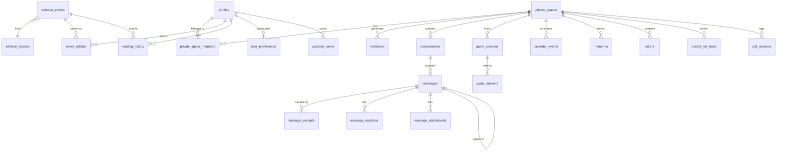

# Database Schema — Project00

> Division 01 output.
> PostgreSQL 15 via Supabase. All migrations in `supabase/migrations/`.
> RLS policies defined in `docs/security-plan.md`.

---

## Entity Relationship Overview



---

## Tables

### Core Identity

#### `profiles`
Extends Supabase `auth.users`. Created automatically via trigger on user registration.

```sql
profiles (
  id            uuid PRIMARY KEY REFERENCES auth.users(id) ON DELETE CASCADE,
  display_name  text NOT NULL CHECK (char_length(display_name) BETWEEN 1 AND 50),
  avatar_url    text,                        -- Supabase Storage path
  bio           text CHECK (char_length(bio) <= 300),
  created_at    timestamptz NOT NULL DEFAULT now(),
  updated_at    timestamptz NOT NULL DEFAULT now()
)
```

---

### Private Spaces

#### `private_spaces`
The core relationship container. Each space is a private 2-person environment.

```sql
private_spaces (
  id            uuid PRIMARY KEY DEFAULT gen_random_uuid(),
  name          text NOT NULL CHECK (char_length(name) BETWEEN 1 AND 100),
  created_by    uuid NOT NULL REFERENCES profiles(id),
  cover_url     text,                        -- Optional space cover image
  created_at    timestamptz NOT NULL DEFAULT now(),
  updated_at    timestamptz NOT NULL DEFAULT now()
)
```

#### `private_space_members`
Membership join table. Enforces the 2-person maximum via trigger.

```sql
private_space_members (
  space_id      uuid NOT NULL REFERENCES private_spaces(id) ON DELETE CASCADE,
  user_id       uuid NOT NULL REFERENCES profiles(id) ON DELETE CASCADE,
  role          text NOT NULL DEFAULT 'member' CHECK (role IN ('owner', 'member')),
  joined_at     timestamptz NOT NULL DEFAULT now(),
  PRIMARY KEY   (space_id, user_id)
)
-- Trigger: before_space_member_insert
-- Raises exception if SELECT COUNT(*) FROM private_space_members WHERE space_id = NEW.space_id >= 2
```

#### `invitations`
Single-use, time-limited invitation tokens.

```sql
invitations (
  id            uuid PRIMARY KEY DEFAULT gen_random_uuid(),
  space_id      uuid NOT NULL REFERENCES private_spaces(id) ON DELETE CASCADE,
  created_by    uuid NOT NULL REFERENCES profiles(id),
  token         text NOT NULL UNIQUE DEFAULT encode(gen_random_bytes(32), 'base64url'),
  expires_at    timestamptz NOT NULL DEFAULT (now() + INTERVAL '7 days'),
  used_at       timestamptz,                 -- NULL = not yet used
  used_by       uuid REFERENCES profiles(id),
  created_at    timestamptz NOT NULL DEFAULT now()
)
```

---

### Messaging

#### `conversations`
One conversation per private space. Created when the space is created.

```sql
conversations (
  id            uuid PRIMARY KEY DEFAULT gen_random_uuid(),
  space_id      uuid NOT NULL UNIQUE REFERENCES private_spaces(id) ON DELETE CASCADE,
  created_at    timestamptz NOT NULL DEFAULT now()
)
```

#### `messages`
Core message table. Supports all message types and disappearing logic.

```sql
messages (
  id                uuid PRIMARY KEY DEFAULT gen_random_uuid(),
  conversation_id   uuid NOT NULL REFERENCES conversations(id) ON DELETE CASCADE,
  space_id          uuid NOT NULL REFERENCES private_spaces(id) ON DELETE CASCADE,
  sender_id         uuid NOT NULL REFERENCES profiles(id),
  
  -- Content
  content           text,                   -- NULL for media-only messages
  message_type      text NOT NULL DEFAULT 'text'
                    CHECK (message_type IN ('text', 'image', 'video', 'voice', 'system')),
  
  -- Threading
  reply_to_id       uuid REFERENCES messages(id) ON DELETE SET NULL,
  
  -- State
  is_edited         boolean NOT NULL DEFAULT false,
  edited_at         timestamptz,
  is_deleted        boolean NOT NULL DEFAULT false,  -- Soft delete for "deleted for me"
  deleted_at        timestamptz,
  is_pinned         boolean NOT NULL DEFAULT false,
  pinned_at         timestamptz,
  pinned_by         uuid REFERENCES profiles(id),
  
  -- Disappearing
  expires_mode      text CHECK (expires_mode IN (
                      'never', 'just_seen', '1_second', '5_minutes',
                      '1_hour', '24_hours', 'custom'
                    )) DEFAULT 'never',
  expires_duration  interval,               -- Used when mode = 'custom'
  expires_at        timestamptz,            -- Authoritative expiry timestamp (server-set)
  
  created_at        timestamptz NOT NULL DEFAULT now()
)

-- Indexes
CREATE INDEX idx_messages_conversation_id ON messages(conversation_id);
CREATE INDEX idx_messages_expires_at ON messages(expires_at) WHERE expires_at IS NOT NULL;
CREATE INDEX idx_messages_sender_id ON messages(sender_id);
```

#### `message_receipts`
Tracks read/viewed state per message per recipient.

```sql
message_receipts (
  message_id    uuid NOT NULL REFERENCES messages(id) ON DELETE CASCADE,
  user_id       uuid NOT NULL REFERENCES profiles(id) ON DELETE CASCADE,
  delivered_at  timestamptz NOT NULL DEFAULT now(),
  viewed_at     timestamptz,                -- NULL until opened
  PRIMARY KEY   (message_id, user_id)
)
```

#### `message_reactions`
Emoji reactions on messages.

```sql
message_reactions (
  id            uuid PRIMARY KEY DEFAULT gen_random_uuid(),
  message_id    uuid NOT NULL REFERENCES messages(id) ON DELETE CASCADE,
  user_id       uuid NOT NULL REFERENCES profiles(id) ON DELETE CASCADE,
  emoji         text NOT NULL CHECK (char_length(emoji) <= 8),
  created_at    timestamptz NOT NULL DEFAULT now(),
  UNIQUE        (message_id, user_id, emoji)
)
```

#### `message_attachments`
Media attached to messages. Stored in Supabase Storage.

```sql
message_attachments (
  id              uuid PRIMARY KEY DEFAULT gen_random_uuid(),
  message_id      uuid NOT NULL REFERENCES messages(id) ON DELETE CASCADE,
  storage_path    text NOT NULL,            -- Supabase Storage object path
  mime_type       text NOT NULL,
  file_size_bytes bigint NOT NULL,
  duration_ms     integer,                  -- For voice/video messages
  width           integer,                  -- For image/video messages
  height          integer,                  -- For image/video messages
  thumbnail_path  text,                     -- Stored thumbnail for video/image
  created_at      timestamptz NOT NULL DEFAULT now()
)
```

---

### Games & Quizzes

#### `question_library`
The seeded question pool. Static content, not user-generated (mostly).

```sql
question_library (
  id            uuid PRIMARY KEY DEFAULT gen_random_uuid(),
  category      text NOT NULL CHECK (category IN (
                  'funny', 'romantic', 'personal', 'childhood',
                  'intellectual', 'hypothetical', 'future', 'intimacy',
                  'couple_trivia', 'compatibility', 'would_you_rather',
                  'truth_or_dare'
                )),
  content       text NOT NULL,
  is_custom     boolean NOT NULL DEFAULT false,
  created_by    uuid REFERENCES profiles(id),   -- NULL for seeded content
  space_id      uuid REFERENCES private_spaces(id), -- NULL for global library
  created_at    timestamptz NOT NULL DEFAULT now()
)
```

#### `question_saves`
Users saving questions from the library.

```sql
question_saves (
  user_id       uuid NOT NULL REFERENCES profiles(id) ON DELETE CASCADE,
  question_id   uuid NOT NULL REFERENCES question_library(id) ON DELETE CASCADE,
  saved_at      timestamptz NOT NULL DEFAULT now(),
  PRIMARY KEY   (user_id, question_id)
)
```

#### `daily_questions`
One question per space per day, locked in at day boundary.

```sql
daily_questions (
  id            uuid PRIMARY KEY DEFAULT gen_random_uuid(),
  space_id      uuid NOT NULL REFERENCES private_spaces(id) ON DELETE CASCADE,
  question_id   uuid NOT NULL REFERENCES question_library(id),
  date          date NOT NULL,
  created_at    timestamptz NOT NULL DEFAULT now(),
  UNIQUE        (space_id, date)
)
```

#### `game_sessions`
A single multiplayer game instance.

```sql
game_sessions (
  id            uuid PRIMARY KEY DEFAULT gen_random_uuid(),
  space_id      uuid NOT NULL REFERENCES private_spaces(id) ON DELETE CASCADE,
  game_type     text NOT NULL CHECK (game_type IN (
                  'couple_trivia', 'compatibility', 'would_you_rather',
                  'guess_partner', 'truth_or_dare', 'custom', 'personality',
                  'memory', 'intellectual'
                )),
  status        text NOT NULL DEFAULT 'waiting'
                CHECK (status IN ('waiting', 'active', 'revealing', 'complete')),
  question_ids  uuid[] NOT NULL DEFAULT '{}',   -- Ordered list of questions
  current_q_idx integer NOT NULL DEFAULT 0,
  scores        jsonb NOT NULL DEFAULT '{}',    -- {user_id: score}
  started_at    timestamptz,
  completed_at  timestamptz,
  created_by    uuid NOT NULL REFERENCES profiles(id),
  created_at    timestamptz NOT NULL DEFAULT now()
)
```

#### `game_answers`
Answers submitted by participants. Hidden until reveal phase.

```sql
game_answers (
  id            uuid PRIMARY KEY DEFAULT gen_random_uuid(),
  session_id    uuid NOT NULL REFERENCES game_sessions(id) ON DELETE CASCADE,
  question_id   uuid NOT NULL REFERENCES question_library(id),
  user_id       uuid NOT NULL REFERENCES profiles(id),
  answer        text NOT NULL,
  submitted_at  timestamptz NOT NULL DEFAULT now(),
  UNIQUE        (session_id, question_id, user_id)
)
-- RLS: SELECT only allowed when game status = 'revealing' or 'complete'
-- This enforces the blind reveal — answers hidden until both submit
```

---

### Shared Experiences

#### `memories`
Shared memory entries with optional media.

```sql
memories (
  id            uuid PRIMARY KEY DEFAULT gen_random_uuid(),
  space_id      uuid NOT NULL REFERENCES private_spaces(id) ON DELETE CASCADE,
  created_by    uuid NOT NULL REFERENCES profiles(id),
  title         text NOT NULL,
  content       text,
  memory_date   date,
  media_paths   text[] DEFAULT '{}',         -- Supabase Storage paths
  tags          text[] DEFAULT '{}',
  created_at    timestamptz NOT NULL DEFAULT now(),
  updated_at    timestamptz NOT NULL DEFAULT now()
)
```

#### `letters`
Digital letters (draft → scheduled/sent).

```sql
letters (
  id            uuid PRIMARY KEY DEFAULT gen_random_uuid(),
  space_id      uuid NOT NULL REFERENCES private_spaces(id) ON DELETE CASCADE,
  author_id     uuid NOT NULL REFERENCES profiles(id),
  subject       text NOT NULL,
  body          text NOT NULL,
  status        text NOT NULL DEFAULT 'draft'
                CHECK (status IN ('draft', 'scheduled', 'sent')),
  scheduled_for timestamptz,                 -- NULL for immediate send
  sent_at       timestamptz,
  created_at    timestamptz NOT NULL DEFAULT now(),
  updated_at    timestamptz NOT NULL DEFAULT now()
)
-- RLS: drafts only visible to author_id; sent letters visible to both
```

#### `calendar_events`
Shared calendar + anniversary reminders.

```sql
calendar_events (
  id              uuid PRIMARY KEY DEFAULT gen_random_uuid(),
  space_id        uuid NOT NULL REFERENCES private_spaces(id) ON DELETE CASCADE,
  created_by      uuid NOT NULL REFERENCES profiles(id),
  title           text NOT NULL,
  description     text,
  event_date      date NOT NULL,
  event_time      time,
  is_recurring    boolean NOT NULL DEFAULT false,
  recurrence_rule text,                       -- iCal RRULE string
  is_anniversary  boolean NOT NULL DEFAULT false,
  reminder_days   integer[] DEFAULT '{1, 7}', -- Days before to remind
  created_at      timestamptz NOT NULL DEFAULT now()
)
```

#### `bucket_list_items`

```sql
bucket_list_items (
  id            uuid PRIMARY KEY DEFAULT gen_random_uuid(),
  space_id      uuid NOT NULL REFERENCES private_spaces(id) ON DELETE CASCADE,
  created_by    uuid NOT NULL REFERENCES profiles(id),
  title         text NOT NULL,
  description   text,
  is_completed  boolean NOT NULL DEFAULT false,
  completed_at  timestamptz,
  completed_by  uuid REFERENCES profiles(id),
  created_at    timestamptz NOT NULL DEFAULT now()
)
```

#### `shared_notes`

```sql
shared_notes (
  id            uuid PRIMARY KEY DEFAULT gen_random_uuid(),
  space_id      uuid NOT NULL REFERENCES private_spaces(id) ON DELETE CASCADE,
  created_by    uuid NOT NULL REFERENCES profiles(id),
  title         text NOT NULL,
  content       text NOT NULL DEFAULT '',
  is_shared     boolean NOT NULL DEFAULT true,  -- false = private journal
  created_at    timestamptz NOT NULL DEFAULT now(),
  updated_at    timestamptz NOT NULL DEFAULT now()
)
-- RLS: is_shared = false → only author_id can read
```

---

### Editorial (Public)

#### `editorial_sources`
Registered publication sources.

```sql
editorial_sources (
  id            uuid PRIMARY KEY DEFAULT gen_random_uuid(),
  name          text NOT NULL,
  slug          text NOT NULL UNIQUE,
  description   text,
  website_url   text NOT NULL,
  rss_url       text,
  logo_url      text,
  accent_color  text,                        -- Hex for publication branding
  is_active     boolean NOT NULL DEFAULT true,
  last_synced   timestamptz,
  created_at    timestamptz NOT NULL DEFAULT now()
)
```

#### `editorial_articles`
Ingested article metadata (never full content).

```sql
editorial_articles (
  id              uuid PRIMARY KEY DEFAULT gen_random_uuid(),
  source_id       uuid NOT NULL REFERENCES editorial_sources(id),
  external_id     text NOT NULL,             -- GUID from RSS feed
  title           text NOT NULL,
  author          text,
  excerpt         text CHECK (char_length(excerpt) <= 500),
  original_url    text NOT NULL,
  og_image_url    text,                      -- Open Graph image URL (external)
  category        text,
  tags            text[] DEFAULT '{}',
  reading_time_min integer,
  published_at    timestamptz,
  ingested_at     timestamptz NOT NULL DEFAULT now(),
  UNIQUE          (source_id, external_id)
)

CREATE INDEX idx_articles_category ON editorial_articles(category);
CREATE INDEX idx_articles_published_at ON editorial_articles(published_at DESC);
CREATE INDEX idx_articles_source_id ON editorial_articles(source_id);
```

#### `saved_articles`

```sql
saved_articles (
  user_id       uuid NOT NULL REFERENCES profiles(id) ON DELETE CASCADE,
  article_id    uuid NOT NULL REFERENCES editorial_articles(id) ON DELETE CASCADE,
  saved_at      timestamptz NOT NULL DEFAULT now(),
  PRIMARY KEY   (user_id, article_id)
)
```

#### `reading_history`

```sql
reading_history (
  id            uuid PRIMARY KEY DEFAULT gen_random_uuid(),
  user_id       uuid NOT NULL REFERENCES profiles(id) ON DELETE CASCADE,
  article_id    uuid NOT NULL REFERENCES editorial_articles(id) ON DELETE CASCADE,
  read_at       timestamptz NOT NULL DEFAULT now(),
  UNIQUE        (user_id, article_id)                  -- Only last read time kept
)
```

---

### Personalisation & Calls

#### `user_preferences`

```sql
user_preferences (
  user_id           uuid PRIMARY KEY REFERENCES profiles(id) ON DELETE CASCADE,
  palette           text NOT NULL DEFAULT 'ivory',
  color_mode        text NOT NULL DEFAULT 'light' CHECK (color_mode IN ('light', 'dark', 'system')),
  font_pairing      text NOT NULL DEFAULT 'editorial-1',
  font_scale        text NOT NULL DEFAULT 'md' CHECK (font_scale IN ('sm', 'md', 'lg', 'xl')),
  density           text NOT NULL DEFAULT 'comfortable' CHECK (density IN ('compact', 'comfortable', 'spacious')),
  bubble_style      text NOT NULL DEFAULT 'soft' CHECK (bubble_style IN ('soft', 'editorial', 'pill', 'minimal')),
  chat_background   text NOT NULL DEFAULT 'none',
  reduced_motion    boolean NOT NULL DEFAULT false,
  discreet_notifs   boolean NOT NULL DEFAULT true,    -- No preview text in push
  reading_history_enabled boolean NOT NULL DEFAULT false,
  updated_at        timestamptz NOT NULL DEFAULT now()
)
```

#### `call_sessions`

```sql
call_sessions (
  id              uuid PRIMARY KEY DEFAULT gen_random_uuid(),
  space_id        uuid NOT NULL REFERENCES private_spaces(id) ON DELETE CASCADE,
  initiator_id    uuid NOT NULL REFERENCES profiles(id),
  call_type       text NOT NULL CHECK (call_type IN ('voice', 'video')),
  status          text NOT NULL DEFAULT 'ringing'
                  CHECK (status IN ('ringing', 'active', 'ended', 'missed', 'declined')),
  livekit_room    text,                      -- LiveKit room name
  started_at      timestamptz,
  ended_at        timestamptz,
  duration_sec    integer,
  created_at      timestamptz NOT NULL DEFAULT now()
)
```

---

## Stored Procedures & RPCs

### `mark_message_viewed(p_message_id uuid, p_user_id uuid)`
Called by client when a message is opened. Sets `viewed_at` and computes `expires_at`.

```sql
CREATE OR REPLACE FUNCTION mark_message_viewed(
  p_message_id uuid,
  p_user_id    uuid
) RETURNS void
LANGUAGE plpgsql SECURITY DEFINER AS $$
DECLARE
  v_expires_mode text;
  v_expires_duration interval;
  v_new_expires_at timestamptz;
BEGIN
  -- Verify caller is a space member (security check)
  IF NOT EXISTS (
    SELECT 1 FROM messages m
    JOIN private_space_members psm ON psm.space_id = m.space_id
    WHERE m.id = p_message_id AND psm.user_id = p_user_id
  ) THEN
    RAISE EXCEPTION 'Access denied';
  END IF;

  -- Update receipt
  INSERT INTO message_receipts (message_id, user_id, viewed_at)
  VALUES (p_message_id, p_user_id, now())
  ON CONFLICT (message_id, user_id) DO UPDATE SET viewed_at = EXCLUDED.viewed_at;

  -- Compute expiry if applicable
  SELECT expires_mode, expires_duration
  INTO v_expires_mode, v_expires_duration
  FROM messages WHERE id = p_message_id;

  v_new_expires_at := CASE v_expires_mode
    WHEN 'just_seen'   THEN now()
    WHEN '1_second'    THEN now() + INTERVAL '1 second'
    WHEN '5_minutes'   THEN now() + INTERVAL '5 minutes'
    WHEN '1_hour'      THEN now() + INTERVAL '1 hour'
    WHEN '24_hours'    THEN now() + INTERVAL '24 hours'
    WHEN 'custom'      THEN now() + v_expires_duration
    ELSE NULL
  END;

  IF v_new_expires_at IS NOT NULL THEN
    UPDATE messages SET expires_at = v_new_expires_at WHERE id = p_message_id
    AND (expires_at IS NULL OR v_new_expires_at < expires_at);
  END IF;
END;
$$;
```

### `consume_invitation(p_token text)`
Used during invitation acceptance flow.

```sql
CREATE OR REPLACE FUNCTION consume_invitation(
  p_token text
) RETURNS uuid   -- Returns space_id on success
LANGUAGE plpgsql SECURITY DEFINER AS $$
DECLARE
  v_invite invitations;
  v_member_count integer;
BEGIN
  SELECT * INTO v_invite
  FROM invitations
  WHERE token = p_token AND used_at IS NULL AND expires_at > now();

  IF NOT FOUND THEN
    RAISE EXCEPTION 'Invalid or expired invitation';
  END IF;

  SELECT COUNT(*) INTO v_member_count
  FROM private_space_members WHERE space_id = v_invite.space_id;

  IF v_member_count >= 2 THEN
    RAISE EXCEPTION 'Space is full';
  END IF;

  IF EXISTS (
    SELECT 1 FROM private_space_members
    WHERE space_id = v_invite.space_id AND user_id = auth.uid()
  ) THEN
    RAISE EXCEPTION 'Already a member';
  END IF;

  INSERT INTO private_space_members (space_id, user_id, role)
  VALUES (v_invite.space_id, auth.uid(), 'member');

  UPDATE invitations
  SET used_at = now(), used_by = auth.uid()
  WHERE id = v_invite.id;

  RETURN v_invite.space_id;
END;
$$;
```

---

*See `docs/security-plan.md` for all RLS policies.*
*See `supabase/migrations/` for the actual SQL migration files.*

