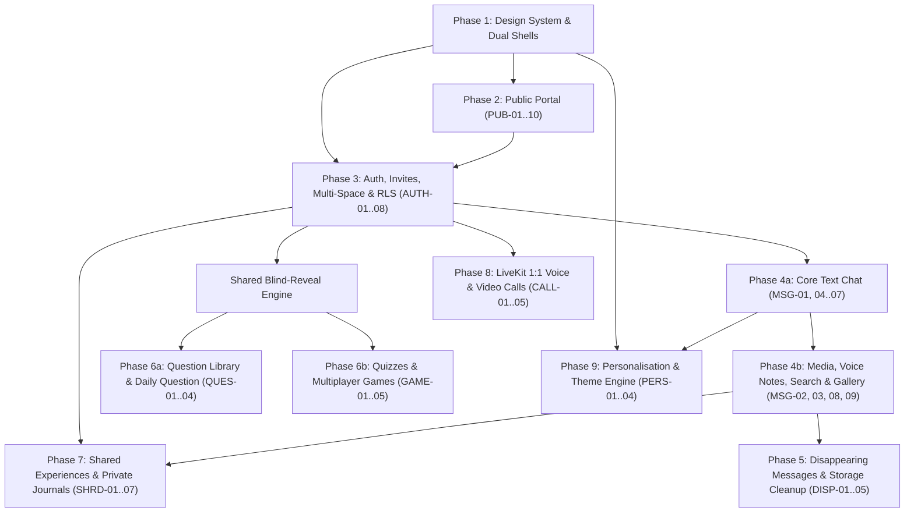

# MVP Scope, Phasing & Dependency Map

**Document Status:** Draft v0.1 (Division 00 — Product Discovery)  
**Purpose:** Separate essential MVP launch scope from full V1 completion milestones and deferred V2+ enhancements, preventing scope creep while protecting architectural integrity.

---

## 1. Release Strategy Overview

Your brief defines a rich, multi-module platform across **10 development phases**. Trying to launch every single module at full depth before releasing *anything* creates high risk of rework and delays user validation.

As a senior PM, I recommend organizing delivery into **three pragmatic tiers** that map directly onto your 10-phase roadmap:

1. **MVP Core (Phases 1–4):** A genuinely usable, secure, aesthetically polished dual-experience product:
   - Complete **Public Editorial Discovery Portal** (all 13 required pages, curated content from the 5 publications, search/filters, saved articles, opt-in reading history).
   - **Verified Authentication, Invitations & 2-Member Private Spaces** with multi-space isolation and verified RLS.
   - **Core Private Messaging** (real-time text, replies, reactions, edits/deletions, read receipts, typing indicators, plus baseline image sharing if low-risk).
2. **Full V1 Completion (Phases 5–9):** Completes every requirement in your Master Brief cleanly in modular increments:
   - **Phase 5:** Server-enforced Disappearing Messages + Media Expiry + Background Cleanup.
   - **Phase 6:** Question Library + Core Games Engine (Daily question, random generator, saved collections, blind-reveal sessions, trivia/compatibility/would-you-rather/guess-partner/truth-or-dare/custom quizzes).
   - **Phase 7:** Shared Experiences & Private Journals (letters, memories, photo albums, shared calendar/dates, bucket lists, shared notes, strictly private journals).
   - **Phase 8:** LiveKit 1:1 Voice & Video Calling + Call History.
   - **Phase 9:** Full Personalisation Engine (palettes, font pairings, bubble styles, chat backgrounds, density, reduced motion).
3. **V2+ Enhancements (Post-Launch / Deferred):** Features that add disproportionate cost, third-party approval delays, or specialized complexity better tackled *after* real users validate V1.

---

## 2. Detailed Feature Allocation

### Tier 1 — MVP Core (Must Be Solid Before Any Private Launch)

| Domain | Included in MVP | Rationale |
| :--- | :--- | :--- |
| **Design System** | Unified token system (Editorial Light + Private Ivory/Charcoal baseline), responsive mobile + desktop shells, loading/empty/error states, WCAG AA contrast | Prevents rework across every future page |
| **Public Portal (`PUB-01..10`)** | Homepage, Discover, 5 Topic pages, Publication Directory + Individual pages, Search & Filters, Curated Collections, Saved Articles, Opt-in Reading History, Discreet Sign-in/Register | Public portal is self-contained, builds organic trust, and validates editorial metadata ingestion early |
| **Auth & Spaces (`AUTH-01..08`)** | Registration, Email verification, Password reset, Session listing & revocation, 2-member Private Space creation, Single-use invite verification, Space switcher, Rate limiting, Security logging, Full 4-persona RLS test suite | Foundational security perimeter—no private data can safely exist without this |
| **Messaging Core (`MSG-01, 04, 05, 06, 07`)** | Real-time 1:1 text chat, replies, reactions, editing, deletion, read receipts, typing indicators | Delivers immediate daily communication utility in the private space |

### Tier 2 — Full V1 Feature Completion (Phases 4b–9)

| Phase | Feature Group | Scope Boundaries for V1 Cleanliness |
| :--- | :--- | :--- |
| **Phase 4b** | Rich Media Messaging (`MSG-02, 03, 08, 09`) | Images, short videos (capped size/duration), voice notes with playback speed/scrubbing, PostgreSQL full-text message search, pinned messages, private media gallery |
| **Phase 5** | Disappearing Messages (`DISP-01..05`) | All 6 expiration modes (`Just seen`, `1s`, `5m`, `1h`, `24h`, `Custom`), server-authoritative timestamps, offline/reconnect cache purge, scheduled DB + storage cleanup, transparent privacy disclosures |
| **Phase 6** | Questions & Core Games (`QUES-01..04`, `GAME-01..05`) | All 8 question categories, Daily question, random generator, saved/custom collections, blind-reveal shared answers; shared quiz/prompt engine powering Couple Trivia, Compatibility, Would-You-Rather, Guess Partner's Answer, Truth or Dare, Custom Quizzes, Intellectual Challenges |
| **Phase 7** | Shared Experiences (`SHRD-01..07`) | Digital letters (draft/send/scheduled), Shared memories + chronological timeline, Photo albums, Important dates + Shared calendar + in-app/email anniversary reminders, Bucket lists, Shared notes (last-write-wins with conflict notice), Strictly isolated Personal Journals & Private Notes |
| **Phase 8** | Voice & Video Calls (`CALL-01..05`) | LiveKit 1:1 audio/video calls, in-app incoming call overlay, mic/camera/PiP controls, permission recovery, network reconnection state, call history |
| **Phase 9** | Personalisation (`PERS-01..04`) | Curated colour palettes (Warm ivory, Beige, Muted burgundy, Sage green, Dusty rose, Soft lavender, Charcoal, Warm grey), Light/Dark modes, 6 curated font families/pairings, font sizes, bubble styles, chat backgrounds, density, reduced-motion & discreet notification preferences |

### Tier 3 — Deferred to V2+ (Explicit Non-Goals for MVP/Early V1)

| Deferred Candidate | Why Defer to V2+ |
| :--- | :--- |
| **True Client-Side E2EE (Double Ratchet / MLS)** *(pending Q3)* | Adds extreme complexity around multi-device key sync, browser key backup/recovery phrases, breaking server-side full-text search, and server-side disappearing cleanup. Revisit only if zero-knowledge threat model is explicitly chosen in Q3. |
| **Specialized Interactive Game UIs (`GAME-01` subset: visual Memory card matching & multi-axis Personality Psychometrics)** | Requires bespoke interactive game-board state machines and psychometric content authoring distinct from the shared quiz/prompt engine; build after the core blind-reveal engine ships cleanly. |
| **Real-Time Multi-Cursor CRDT Collaborative Notes (`SHRD-06`)** | Integrating Yjs/Liveblocks/CRDT state adds substantial infrastructure complexity for minimal gain when 2 partners mostly edit sequentially. Standard save + conflict detection handles 99% of cases cleanly. |
| **Native Mobile Push / CallKit Background Wakeup (`CALL-02` extension)** | Browsers/PWAs cannot reliably wake a completely closed iOS app for incoming calls; requires dedicated native iOS/Android wrappers (React Native / Capacitor) in V2. |
| **Automated Publisher Content Enrichment / Scraping Fallbacks** | Risky legally (`RSK-01`) and brittle; V1 sticks strictly to official RSS/metadata + manual curation. |
| **Custom Theme Color-Wheel Picker & Arbitrary Image Wallpaper Upload for Chat Backgrounds** | Arbitrary user colors frequently break WCAG contrast and look cluttered; V1 curates designer-verified palettes and calm preset textures/colors. |
| **Public User-Submitted Collections or Social Comments on `www`** | Turns the calm editorial portal into a moderation/spam burden; unnecessary for product vision. |

---

## 3. Feature Dependency Map

### Critical Path Dependencies
1. **Nothing Private Can Precede `AUTH-06` (RLS & 2-Member Space Policy):** Every private table (`messages`, `memories`, `journals`, `calls`, `games`) depends on `private_spaces` and `private_space_members`.
2. **Encryption Choice (`Q3`) Gates `MSG-08` & `DISP-04`:** Decide RLS-at-rest vs. client-side E2EE *before* designing `messages` columns and search indexes.
3. **Media Storage Architecture (`MSG-02`) Gates `DISP-04` & `SHRD-03`:** One unified private bucket path convention (`spaces/{space_id}/...`) and signed-URL helper prevents duplicated security code across Chat Media, Voice Notes, Disappearing Attachments, and Shared Photo Albums.
4. **Blind-Reveal Primitive (`GAME-03`) Serves Both `GAME` & `QUES-04`:** Building one rock-solid PostgreSQL/RPC blind-reveal mechanism eliminates duplicate logic across Games and Question Sessions.

---

## 4. Infrastructure & Cost Guardrails (Starting Simple)

| Service | Initial Usage Profile | Key Cost / Limit Risks | MVP Guardrails |
| :--- | :--- | :--- | :--- |
| **Vercel** | Hosting Next.js (`www` + `app` via middleware) | Bandwidth & serverless execution duration on Hobby vs. Pro (commercial apps require Pro) | Cache public editorial pages with ISR (`revalidate`); keep private API routes lean |
| **Supabase** | Postgres + Auth + Storage + Realtime + Edge Functions | Free tier pauses after 7 days inactivity and lacks PITR backups; Storage egress & Realtime concurrent connection caps | Use Pro tier (`~$25/mo`) once real users onboard; cap image/video upload sizes; clean up expired disappearing media promptly |
| **LiveKit Cloud** | 1:1 WebRTC SFU for Voice & Video | Free tier has monthly participant-minute / bandwidth limits | Cap rooms strictly to `2` participants, enforce call duration timeout/idle auto-disconnect, disable unused HD simulcast layers for voice-only calls |
| **Transactional Email** | Auth verification, password reset, optional invite/reminder emails | Supabase built-in SMTP has very low hourly rate limits (unsuitable beyond dev testing) | Configure custom SMTP (e.g., Resend / Postmark free/low tier) before Phase 3 testing/launch |

